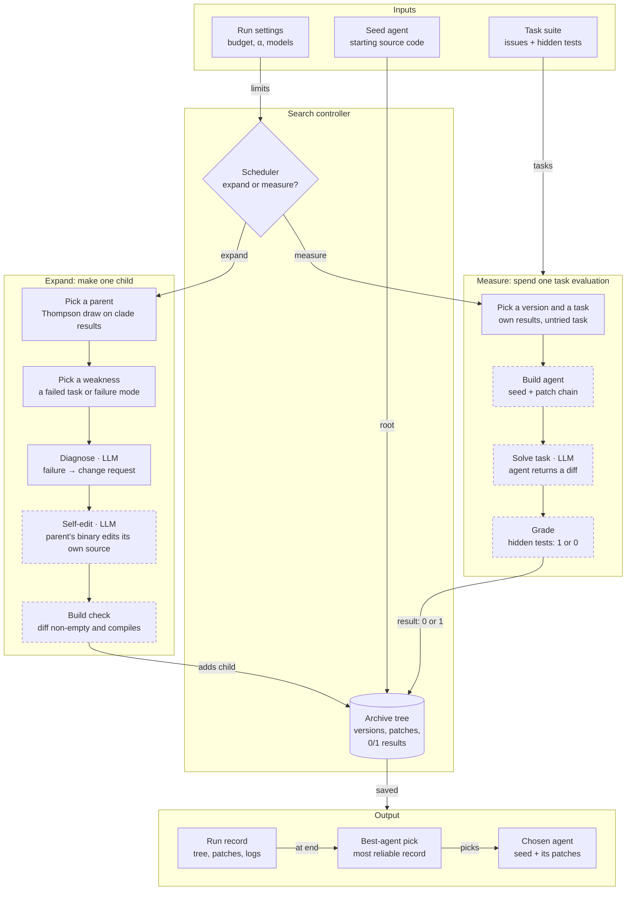
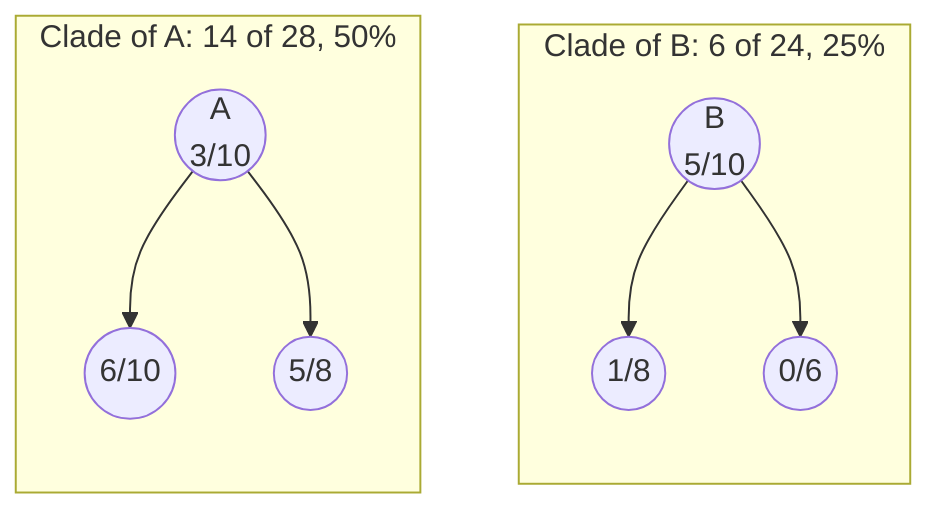
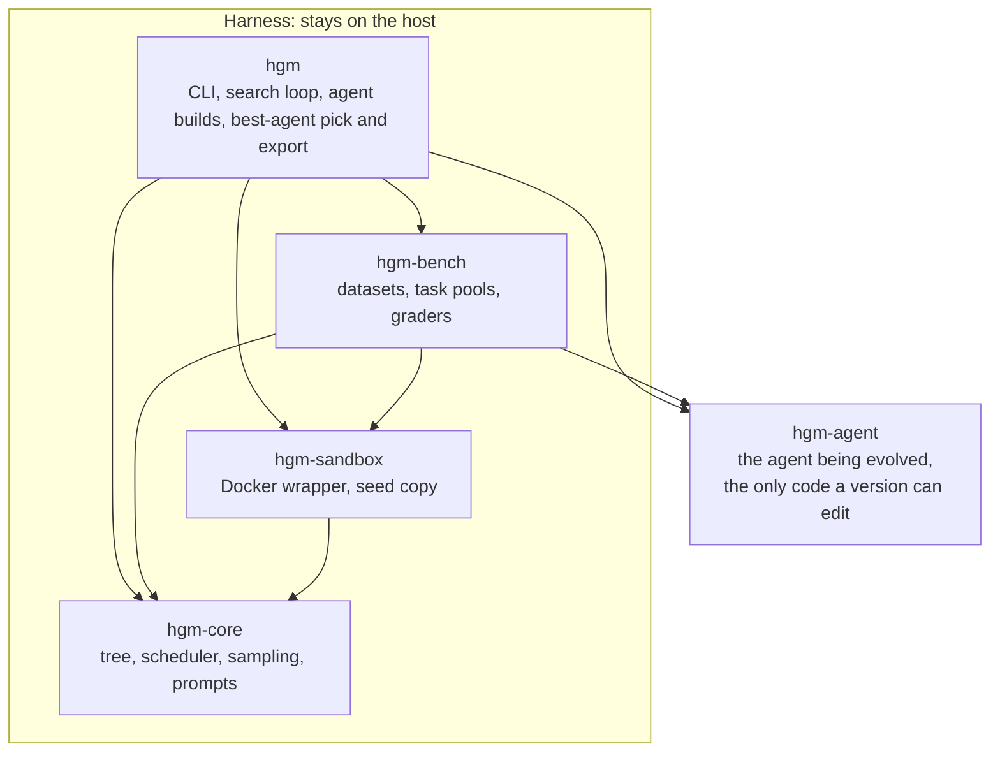

# RustyHGM

RustyHGM is a Rust port of the [Huxley-Gödel Machine](https://github.com/metauto-ai/HGM) (HGM), a self-improving machine that uses clade-level statistics to approximate the Gödel machine, a program that rewrites its own code whenever it can prove that the change will make it better at its goal. HGM improves a coding agent by having the agent rewrite its own source, with every rewrite becoming a new version. It tests those versions on coding tasks and scores each by how often it succeeds, stopping after a set number of tests in total.

HGM is based on the paper [*Huxley-Gödel Machine: Human-Level Coding Agent Development by an Approximation of the Optimal Self-Improving Machine*](https://arxiv.org/abs/2510.21614) published by Wenyi Wang, Piotr Piękos, Li Nanbo, Firas Laakom, Yimeng Chen, Mateusz Ostaszewski, Mingchen Zhuge, and Jürgen Schmidhuber.

## Commands

RustyHGM is one command, `hgm`, with no sub-commands. You run it and get back a better agent. Build it, then run it from the repository root, since it looks for `config.yaml`, `Dockerfile`, `polyglot/` and `output_hgm/` relative to the working directory.

```sh
cargo build --release -p hgm
target/release/hgm [flags]
```

One run does the whole job:

1. **Fetches task data** it doesn't have yet. For `--polyglot` runs, that means cloning the [Aider Polyglot benchmark](https://github.com/Aider-AI/polyglot-benchmark) into `polyglot/polyglot-benchmark` and writing its task list to `polyglot/polyglot_benchmark_metadata.json`.
2. **Improves the agent** until the task budget is spent. On the first run with a given agent name, it also copies the seed agent and measures it on every task in the pool.
3. **Picks the best version**: the one with the highest success rate it can trust, given how many tasks it was tried on.
4. **Writes that version's source** to `output_hgm/<run>/best_agent/` and prints where it went. This folder is the improved agent: the seed with every patch on its line applied.
5. **Optionally scores it on held-out tasks** with `--holdout_split`. These are SWE-bench tasks it never practised on, so the score shows whether it really got better.

```sh
target/release/hgm --max_task_evals 100 --holdout_split Lite --holdout_tasks 50
```

`hgm --help` lists the flags, and `hgm --version` prints the version. Flag names use underscores, as in `--max_task_evals 100`, and a value can also be joined with `=`, as in `--max_task_evals=100`. If a run stops early, `--continue_from output_hgm/<run>` resumes it.

### Before a run

- **Docker.** Every build, self-edit and task runs in a container. `HGM_DOCKER` names a different Docker-compatible program.
- **A model API key.** Models whose names contain `gpt` or start with `o` use `OPENAI_API_KEY`. Every other model goes through OpenRouter with `OpenRouter_API_KEY`.
- **Python 3 with the `swebench` package** for SWE-bench grading. `HGM_SWEBENCH_PYTHON` picks the interpreter.
- **git**, for fetching the Polyglot benchmark and writing the best agent's source.

### Flags

Settings are read from `config.yaml` first, and each flag with a config key replaces that key. The defaults shown are the ones in the repository's `config.yaml`.

| Flag | Config key | Default | What it sets |
| --- | --- | --- | --- |
| `--config <file>` | | `config.yaml` | The settings file to read |
| `--max_task_evals <n>` | `execution.max_task_evals` | `800` | Total task evaluations in the run's budget |
| `--max_workers <n>` | `execution.max_workers` | `20` | Ticks and task evaluations run at the same time |
| `--self_improve_timeout <secs>` | `execution.self_improve_timeout` | `3600` | Time limit for one self-edit |
| `--evaluation_timeout <secs>` | `execution.evaluation_timeout` | `3600` | Time limit for one task attempt |
| `--self_improve_llm <model>` | `llm.self_improve_llm` | `gpt-5-mini` | Model the agent uses while it edits itself |
| `--downstream_llm <model>` | `llm.downstream_llm` | `gpt-5-mini` | Model the agent uses while it solves tasks |
| `--diagnose_llm <model>` | `llm.diagnose_llm` | `gpt-5-mini` | Model that turns a failure into a change request |
| `--alpha <x>` | `optimization.alpha` | `0.6` | How bushy the tree grows: more children per evaluation as it rises |
| `--cool_down`, `--no_cool_down` | `optimization.cool_down` | off | Sharpens every draw as the budget runs out |
| `--beta <x>` | `optimization.beta` | `1.0` | How fast `cool_down` sharpens; ignored without it |
| `--expansion_statistic <clade\|own>` | `optimization.expansion_statistic` | `clade` | Whether a parent is judged on its whole clade or on its own results |
| `--n_pseudo_descendant_evals <n>` | `optimization.n_pseudo_descendant_evals` | `10000` | Caps how many of a version's own results count in its clade pool |
| `--eval_random_level <p>` | `optimization.eval_random_level` | `1.0` | Odds of picking an untried task at random, rather than the next one in pool order |
| `--polyglot`, `--no_polyglot` | `evaluation.polyglot` | off | Uses the Polyglot benchmark instead of SWE-bench |
| `--full_eval` | `evaluation.full_eval` | off | Uses all 500 SWE-bench Verified tasks instead of the 60-task pool |
| `--output_dir <dir>` | `paths.output_dir` | `output_hgm/<timestamp>` | Where the run record goes |
| `--continue_from <dir>` | `paths.continue_from` | none | An earlier run to resume; the record continues in `output_hgm/<its folder name>` unless `--output_dir` is given |
| `--initial_agent_name <name>` | `paths.initial_agent_name` | `default_agent` | Name of the seed agent's folder and Docker image |
| `--epsilon <p>` | | `0.01` | How cautious the final pick is: each version is scored by this percentile of its Beta posterior |
| `--holdout_split <name>` | | none | After the run, scores the best agent on `princeton-nlp/SWE-bench_<name>`, such as `Lite`; not allowed with `--polyglot` |
| `--holdout_tasks <n>` | | all | Scores only the first `n` held-out tasks |

The first run with a given agent name copies the seed into `initial_swe/<name>/` or `initial_polyglot/<name>/` and measures it on every task in the pool. Later runs reuse that folder and its results, so delete it to measure a changed seed again.

The held-out check uses the `--downstream_llm` model, the `--evaluation_timeout` limit and `--max_workers`, and writes its results to `output_hgm/<run>/holdout/best_agent/`.

### Environment variables

| Variable | What it sets |
| --- | --- |
| `OPENAI_API_KEY` | Key for OpenAI models; passed into the agent's containers |
| `OpenRouter_API_KEY` | Key for every other model; passed into the agent's containers |
| `ANTHROPIC_API_KEY`, `AWS_REGION`, `AWS_REGION_NAME`, `AWS_ACCESS_KEY_ID`, `AWS_SECRET_ACCESS_KEY` | Passed into the agent's containers unchanged |
| `OPENAI_BASE_URL` | Endpoint for OpenAI models on the host |
| `HGM_LLM_BASE_URL` | One endpoint for every model on the host |
| `HGM_SWEBENCH_PYTHON` | Python interpreter that runs `swebench` grading, `python3` by default |
| `HGM_HF_ENDPOINT` | Hugging Face mirror for datasets, `https://huggingface.co` by default |
| `HGM_DATA_DIR` | Dataset cache, `~/.cache/hgm/datasets` by default |
| `HGM_DOCKER` | Container program, `docker` by default |
| `HGM_POLYGLOT_REPO` | Clone URL for the Polyglot benchmark |

### The agent binary

The harness also builds `hgm-agent`, the agent being evolved, and runs it inside containers. It can be run by hand to watch one attempt, with `cargo run -p hgm-agent -- <flags>`.

| Flag | Default | What it sets |
| --- | --- | --- |
| `--problem_statement <text>` | required | The task or change request |
| `--git_dir <dir>` | required | The repository to work in |
| `--base_commit <sha>` | required | The commit the final diff is taken against |
| `--chat_history_file <file>` | required | Where the conversation log is written |
| `--outdir <dir>` | `/hgm/` | Where `model_patch.diff` is written |
| `--model <model>` | `gpt-5`, or `anthropic/claude-sonnet-4` with `--polyglot` | Model to use |
| `--timeout <secs>` | `3600` | Time limit for the attempt |
| `--self_improve` | off | Edits the agent's own source rather than solving a task |
| `--polyglot` | off | Uses Polyglot prompts and tests |
| `--language <lang>` | `python` | Polyglot task language: `cpp`, `java`, `python`, `go`, `rust` or `javascript` |
| `--test_description <text>` | none | How to run the repository's tests |
| `--instance_id <id>` | none | The task's ID, used for logging |

## How it works

Three ideas carry the whole design:

- **The agent is both the subject and the tool.** The same `hgm-agent` binary solves benchmark tasks and, with `--self_improve`, edits its own source. A child version is written by its parent.
- **A version is the seed plus a chain of patches.** Each version stores only its own diff and its parent's ID. Building a version replays every diff from the root down.
- **Parents are chosen by their clade.** A version's promise is judged on its own results pooled with the results of all its descendants, which the paper calls clade metaproductivity. Julian Huxley coined the word clade, which is the Huxley in the name. The Gödel half comes from the Gödel machine, which rewrites itself only after proving that the rewrite helps. HGM replaces the proof with measurement.

### Concept view

The boxes name concepts, and the [concept to code](#concept-to-code) table names the code behind each one. Dashed borders mark steps that run inside a container, and `· LLM` marks steps that call a language model.



The controller keeps one tree of agent versions. On every tick it either grows the tree (Expand) or spends one task evaluation on one version (Measure). Both write their result back into the tree, and the scheduler decides which one runs next.

### One tick, step by step

Up to `max_workers` ticks run at once. Expanding costs time and model calls but no evaluation budget. Only measuring spends the budget.

#### Expand: make one child

1. **Pick a parent.** Every version gets one random draw from $\mathrm{Beta}(1 + \text{solved}, 1 + \text{failed})$, counted over its whole clade, and the highest draw wins. Only versions that have solved at least one task can be parents.
2. **Set up.** Start a container from the agent image, which holds the seed source and the Rust toolchain. Replay the parent's patch chain, commit it as the base, and compile.
3. **Pick a weakness.** Usually a task the parent failed. On SWE-bench it is sometimes a known failure mode instead: empty patches, run-to-run variance, or context overflow, each at 25% odds.
4. **Diagnose.** The diagnosis model reads the agent's code, the failed attempt's chat log and test output, and the task's hidden test patch. It writes a change request addressed to the agent.
5. **Self-edit.** The parent's own compiled binary runs with `--self_improve` against its source in `/hgm`. It can run the agent's unit tests while it works.
6. **Check.** The diff against the base must be non-empty and must compile. It is saved as the child's `model_patch.diff`, and the child joins the tree with no results yet.

A failure at any step discards the child and leaves the tree unchanged.

#### Measure: spend one task evaluation

1. **Pick a version.** The same Thompson draw, but on each version's own results. A new version starts at $\mathrm{Beta}(1, 1)$, so it gets measured early.
2. **Pick a task.** One that version has not tried yet, at random from the pool.
3. **Build.** Replay the seed and patch chain in a builder container and compile a static musl binary. The binary is cached per version.
4. **Solve.** Start the task's own container, which holds the repository at the issue's base commit. Copy the binary in and run it on the problem statement. It returns a diff.
5. **Grade.** Run the task's hidden tests against that diff. A solved task appends a 1 to the version's results, and anything else appends a 0.

Each measurement adds one result to one version, and that result also counts toward the clade of every ancestor.

### Why clades and not own scores

A version that scores well can still be a poor parent, and a weak version can start a strong line, so HGM bets on lineages. In this example, two candidate parents have had the same number of evaluations. Each circle is a version showing tasks solved over tasks tried, and arrows point from parent to child.



- Ranking by own results favours B (50% against 30%), which wins about 81% of Thompson draws.
- Pooling the clade, as `--expansion_statistic clade` does, favours A (50% against 25%), which wins about 97% of draws.

Thompson sampling keeps some randomness on purpose, so the losing candidate still gets expanded now and then. The odds come from simulating $\mathrm{Beta}(15, 15)$ against $\mathrm{Beta}(7, 19)$ for the clades, and $\mathrm{Beta}(4, 8)$ against $\mathrm{Beta}(6, 6)$ for the own results.

### Pace and budget

The scheduler expands while $n^{\alpha} \geq c + p$, where $n$ is the number of task evaluations so far, $c$ the number of children so far, and $p$ the number of expansions in flight. Otherwise it measures. A larger $\alpha$ grows a bushier tree with fewer measurements per version. With the defaults in `config.yaml`:

- **800** task evaluations per run.
- **About 55** children allowed by the end, since $800^{0.6} \approx 55.2$, and about 16 after 100 evaluations.
- **5** children of the seed made in parallel before measuring starts.
- **60** tasks in the default SWE-bench pool. The seed is measured on all of them first, outside the budget.

The 55 is a ceiling. Failed expansions add no node, so real trees are smaller. With `--cool_down`, $\beta$ sharpens every Beta draw as the budget runs out, which shifts the search from exploring toward exploiting.

To choose the final agent, `hgm` ranks versions by the 1st percentile ($\varepsilon = 0.01$) of $\mathrm{Beta}(1 + \text{solved}, 1 + \text{failed})$ on their own results. That rewards a high success rate backed by enough evaluations to trust it.

## Code

### Concept to code

| Concept | Code |
| --- | --- |
| Seed agent | `src/agent` (crate `hgm-agent`), copied through the `.dockerignore` filter into `initial_swe/<name>/src` or `initial_polyglot/<name>/src` |
| Task suite | SWE-bench Verified from Hugging Face (a 60-task default pool, or all 500 with `--full_eval`), or the Aider Polyglot benchmark (59 tasks after de-duplication) |
| Run settings | `config.yaml`, with every key overridable by an `hgm` flag |
| Archive tree | `hgm_core::tree`. A snapshot is appended to `hgm_metadata.jsonl` after every change, and each version has its own `metadata.json` |
| Scheduler | `should_expand` in `src/core/scheduler.rs`. The tick loop is `Search::run` in `src/hgm/search.rs` |
| Pickers | Thompson sampling over Beta posteriors in `src/core/sampling.rs` |
| Weakness and diagnosis | `choose_entry` and `diagnose_problem` in `src/hgm/improve.rs`, with prompts in `src/core/prompts/` |
| Self-edit | `hgm-agent --self_improve` in a container built from the repository's `Dockerfile` (`rust:latest` plus musl) |
| Agent build | `cargo build --release --target <arch>-unknown-linux-musl -p hgm-agent` in a builder container (`src/hgm/agent_build.rs`) |
| Coding agent | The `hgm-agent` binary: a language-model tool loop with bash and editor tools that ends by writing `model_patch.diff` |
| Task sandbox and grader | SWE-bench instance images graded by the `swebench` Python package, or Polyglot per-language images and test commands (`src/bench`) |
| Language models | OpenAI, OpenRouter, or any compatible endpoint (`src/agent/llm.rs`) |
| Containers | The Docker CLI, wrapped by `hgm-sandbox` (`src/sandbox/docker.rs`) |
| Run record | `output_hgm/<run>/`, holding each version's patch, compiled binary, chat logs and predictions |
| Best-agent pick | `pick` and `export` in `src/hgm/best.rs`, writing `output_hgm/<run>/best_agent/` |

### Crates and the edit boundary

The workspace has five crates. Four are the harness, and they stay on the host. One is the agent, and it is the only code that goes into the sandbox. Arrows point from a crate to the crates it depends on.



`hgm-agent` depends on no other workspace crate, so it builds on its own inside the sandbox. The harness reuses its language-model client and test text from the seed copy, never from an evolved version. The `.dockerignore` filter keeps `src/bench`, `src/core`, `src/hgm`, `src/sandbox` and their tests out of the seed. A version can rewrite itself, but it never sees or touches the controller that picks it or the grader that scores it.
